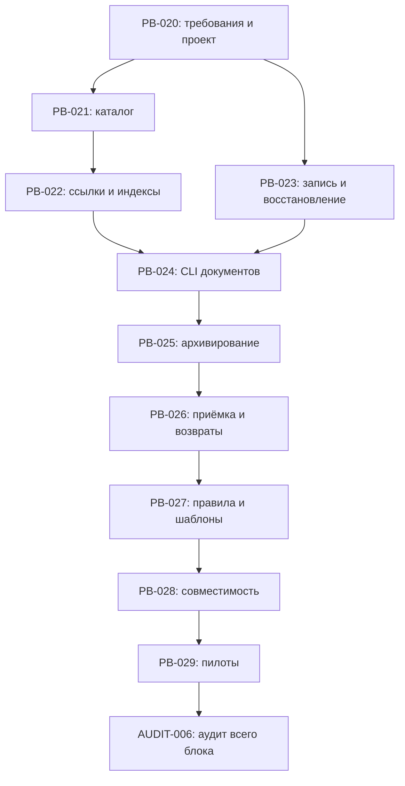

# План: режимы работы и жизненный цикл документов

<!-- playbook-meta:start -->
```json
{
  "schema_version": 1,
  "document_id": "plan:workflow-and-document-lifecycle",
  "kind": "plan",
  "state": "completed",
  "created_at": "2026-10-01T03:05:15+03:00",
  "updated_at": "2026-10-22T13:36:15+03:00",
  "current_revision": 1,
  "relations": [
    {
      "relation": "based_on",
      "target": "spec:workflow-and-document-lifecycle"
    },
    {
      "relation": "based_on",
      "target": "design:workflow-and-document-lifecycle"
    }
  ],
  "tasks": [
    "PB-021",
    "PB-022",
    "PB-023",
    "PB-024",
    "PB-025",
    "PB-026",
    "PB-027",
    "PB-028",
    "PB-029",
    "AUDIT-006"
  ],
  "changes": [],
  "materials": [
    {
      "id": "pre-a3-history",
      "role": "other",
      "source": "docs/archive/plans/workflow-and-document-lifecycle-evidence/pre-a3-20261022.txt",
      "storage": "local",
      "required": true,
      "immutable": true,
      "used_by": []
    },
    {
      "id": "lifecycle-lc-37f88f86bff4cf6c",
      "role": "report",
      "source": "docs/archive/plans/workflow-and-document-lifecycle-evidence/archive-lc-37f88f86bff4cf6c.json",
      "storage": "local",
      "required": true,
      "immutable": true,
      "used_by": []
    }
  ],
  "archive": {
    "at": "2026-10-22T13:36:15+03:00",
    "reason": "Завершение принятого блока PB-021–PB-029 и AUDIT-006",
    "successor": null,
    "operation_id": "lc-37f88f86bff4cf6c",
    "original_path": "docs/plans/workflow-and-document-lifecycle.md"
  },
  "moves": [
    {
      "from": "docs/plans/workflow-and-document-lifecycle-evidence/pre-a3-20261022.txt",
      "to": "docs/archive/plans/workflow-and-document-lifecycle-evidence/pre-a3-20261022.txt"
    },
    {
      "from": "docs/plans/workflow-and-document-lifecycle.md",
      "to": "docs/archive/plans/workflow-and-document-lifecycle.md"
    }
  ]
}
```
<!-- playbook-meta:end -->

Состояние документа: реализация PB-021–PB-029 завершена и принята инженером; итоговая AUDIT-006 ожидает приёмки. План подготовлен к совместному архивированию только после закрытия аудита.
Создан: 2026-10-01. Обновлён: 2026-10-22.
Основание: инженер разрешил перейти от проектирования к следующему шагу; это разрешение на планирование, не запуск реализации или независимого аудита.
Подготовка: [PB-020](../tasks/PB-020.md).
Требования: [спецификация](../../specs/workflow-and-document-lifecycle.md).
Техническое решение: [design](../../designs/workflow-and-document-lifecycle.md), [ADR-0001](../../adr/0001-document-owned-metadata.md), [ADR-0002](../../adr/0002-recoverable-lifecycle-operations.md).

## 1. Результат и границы

Внедрить восемь режимов и три маршрута задач; учёт документов, материалов и связей; вычисляемые индексы; безопасное закрытие/архивирование/возврат; независимую приёмку и совместимость существующих установок.

Процедура «Интеграция playbook» остаётся отдельной темой. Автоматический запуск новых сессий/аудиторов, публикация релиза, commit/push/merge не входят. Номер будущей версии выбирается перед подготовкой артефакта обновления, не назначается этим планом.

Команды и модули design реализованы в PB-021–PB-029; их статусы и приёмка хранятся в карточках. При планировании созданы draft-карточки. Такое раннее разделение крупного блока требуется действующими [правилами задач](../../../ai-dev-playbook/rules/tasks.md); этап постановки уточняет готовность и исполнителей, не создаёт дубли этих карточек.

## 2. Условия начала

1. Инженер/независимый аудитор принимает подготовленные требования, design, ADR и план в PB-020. Переход к планированию не считается независимой приёмкой этой работы; её автор не закрывает PB-020 сам.
2. Для выбранной подзадачи завершены зависимости, уточнены границы/приёмка и приняты необходимые решения. После этого карточка может перейти из draft в ready. Разрешение на выполнение и назначение фактического исполнителя/модели проверяются при запуске in_progress; отсутствие назначения само по себе не препятствует ready.
3. Исполнитель сверяет текущее рабочее дерево и ресурсы. Существующие незакоммиченные изменения сохраняются; commit не является условием проверки, но идентичность входов фиксируется.
4. Перед первой реализацией — исходный прогон существующей suite и структурной проверки с записью ограничений. Старые результаты проверок из других карточек не подменяют этот прогон.

Приоритет всех подзадач предложен P2, очередь других активных работ не меняется. Ветки/checkout и исполнители определяются при запуске; наличие независимых ветвей графа не разрешает автоматически запускать агентов.

## 3. Декомпозиция и порядок

| Шаг | Карточка и самостоятельный результат | Непосредственные зависимости |
|---|---|---|
| 1 | [PB-021](../tasks/PB-021.md): схема метаданных, каталог, связи и владельцы материалов; read-only анализ | PB-020 |
| 2 | [PB-022](../tasks/PB-022.md): единый разбор ссылок, карта переносов и детерминированные индексы | PB-021 |
| 3 | [PB-023](../tasks/PB-023.md): восстанавливаемая запись, блокировка команд, backup и журнал | PB-020 |
| 4 | [PB-024](../tasks/PB-024.md): создание/регистрация документов и безопасное обновление индексов через CLI | PB-022, PB-023 |
| 5 | [PB-025](../tasks/PB-025.md): планирование и применение архивирования документов с материалами | PB-024 |
| 6 | [PB-026](../tasks/PB-026.md): приёмка, close/reopen, ревизии требований и передача доказательств | PB-025 |
| 7 | [PB-027](../tasks/PB-027.md): правила восьми режимов, маршруты, шаблоны и руководство | PB-026 |
| 8 | [PB-028](../tasks/PB-028.md): совместимость, init и обновление существующей установки | PB-027 |
| 9 | [PB-029](../tasks/PB-029.md): сквозные пилоты, три маршрута и самоприменение | PB-028 |
| 10 | [AUDIT-006](../tasks/AUDIT-006.md): независимая приёмка всего блока | Все PB-021–PB-029 |

Рекомендуемый порядок исполнения — сверху вниз. PB-023 не зависит от готовности PB-022 и может готовиться после PB-020, но для PB-024 нужны обе ветви. Любая зависимость означает done после собственной независимой приёмки, а не только успешную самопроверку. Аудит одной подзадачи записывается в её карточке; AUDIT-006 проверяет совместный результат и не заменяет эти приёмки.



Последняя стрелка на схеме показывает момент готовности блока; в AUDIT-006 явно записаны зависимости от всех девяти подзадач.

## 4. Проверки по результатам

| Карточка | Основные сценарии и отрицательные случаи | Доказательство |
|---|---|---|
| PB-021 | Дубли ID/ключей, неизвестная схема, fenced-пример вместо metadata, legacy, циклы replaces/задач, один владелец, пересечение каталогов, symlink/выход за корень | Тесты чтения/валидации и read-only CLI; дерево до/после одинаково |
| PB-022 | Входящие/исходящие/self/взаимные ссылки, изображения, reference definitions, пробелы/encoding/query/fragment, исключение кода и immutable; индексы не теряют ручные части | Фикстуры и сравнение ожидаемых адресатов/байтов; повторная генерация без diff |
| PB-023 | Ошибка записи/индекса, прерывание в каждой фазе и при restore, чужой pending, live-lock, повреждённый backup, поздняя внешняя правка, совместимость с update | Подпроцессы, fault injection, полный снимок/права/состав до и после восстановления |
| PB-024 | Preview без записи; create/register apply; сохранность тела legacy; коллизия имени/индекса; stale inputs; повторный index; check ничего не исправляет | CLI в настроенном временном проекте, stdout/exit code и сравнение ФС |
| PB-025 | Несколько документов/evidence за один перенос, неполный учёт, активные потребители общих материалов, bytes immutable, внешнее доказательство недоступно, изменённый план/новый файл | CLI-сценарии полного переноса и отказов, hashes, карта путей и доступность доказательств |
| PB-026 | Маленькая карточка → verify → in_review; закрытие по отдельной приёмке; изменение значимого входа; promotion; частичная/полная отмена; reopen закрытой подзадачи и зависимый блок | Сценарии CLI плюс проверка границ процесса; исторические протоколы/Closed сохраняются |
| PB-027 | Восемь режимов и три маршрута; самопроверка не выдаётся за аудит; обсуждение без записи; полномочия; актуальная/планируемая редакция; исключённые режимы не теряют setup-функции | Сверка правил/шаблонов/команд с рабочим CLI; подготовленные сценарии пилота |
| PB-028 | Новая установка, 0.0.2 со своими путями, metadata без массового архива, конфликт чужого файла, manifest, staged-проверки, прерывание обновления и restore | Локальный артефакт, копия старой установки, отчёты update и побайтовая сохранность проектных данных |
| PB-029 | Маленький баг, средняя feature с частичной заменой, крупный блок с отдельными подприёмками и замечанием общего аудита; отмена/возобновление; собственный проект | Пилот с исполнителем и отдельной сессией аудитора/инженером; полный пакет передачи и фактические ограничения |
| AUDIT-006 | Независимое повторение критических путей и остаточные риски, все AC-01–AC-12, документация и основания финального архива | Протокол независимого аудитора, находки/повторные проверки, итоговое состояние |

Фикстуры должны включать два связанных документа, две подзадачи, общую AUDIT-карточку, Markdown-отчёт, картинку, JSON-результат verify, разовый probe и постоянный тест вне evidence. Проверять нормальный путь и отказ без частичного изменения, а не только текст сообщения об ошибке. Ранние задачи пишут свои тесты сразу; PB-029 не становится первым этапом тестирования.

## 5. Среды, команды и материалы

Доступная основа: Python 3.10+ / standard library и существующий unittest. В проекте уже объявлены:

```text
python3 -m unittest discover -s tests -v
python3 ai-dev-playbook/scripts/playbook.py index
python3 ai-dev-playbook/scripts/playbook.py check --ready
python3 ai-dev-playbook/scripts/playbook.py verify <ID> --dry-run
python3 ai-dev-playbook/scripts/playbook.py verify <ID>
```

Перед verify исполнитель проверяет актуальные argv и inputs в project.json. Имена будущих тестовых модулей определяются при реализации; существующая общая команда должна собирать новые тесты без отдельного скрытого runner. Точечные проверки выполняются после логического изменения, полный набор — перед передачей подзадачи; повторять неизменившиеся прогоны без причины не требуется.

Переносы и отказы проверяются в настроенном временном проекте. Самоприменение сначала выполняется на копии текущего дерева, включая нужные незакоммиченные документы; исходный пользовательский checkout не служит полигоном прерываний. Обновление испытывается на локальном артефакте, без публикации. Для блокировок зафиксировать фактическую ОС: POSIX-проверка не доказывает Windows; неподтверждённые платформы явно ограничить до приёмки. Verify сейчас требует POSIX, это не расширяется молча.

Доказательства подзадачи сохраняются в `docs/tasks/<ID>-evidence/`, общий протокол — в `docs/tasks/AUDIT-006.md`, материалы общего аудита — в `docs/tasks/AUDIT-006-evidence/`. Каталоги создаются по мере появления содержимого. У каждого прогона: команда/сценарий, время, исполнитель/модель, среда, результат, входные хеши, ограничения. Файл отчёта сам не включается в собственный входной hash. Непроверенное не отмечается пройденным.

Постоянные тесты остаются в `tests/`; logs/screenshots/probes и материалы операций архивируются с владельцем. Большие внешние доказательства имеют доступную устойчивую ссылку. После изменений файлов комплекта исполнитель обновляет self-manifest согласно AGENTS.md и повторяет относящиеся проверки; ни план, ни его успешная структурная проверка не требуют adopt.

## 6. Контрольные точки и восстановление

- До PB-024 нет нового пользовательского пути записи документов: сначала проверены каталог, преобразования и механизм восстановления. PB-024 не должен временно писать через небезопасный обход будущего engine.
- До готовности PB-026 старый close не получает скрыто урезанную семантику новой приёмки. Включение нового engine — отдельный проверяемый результат PB-026; старые сценарии close/update остаются в регрессии.
- В PB-023 сохраняется старый формат восстановления update; интеграция общего gate проверяется до подключения новых операций. При прерывании доступны status/нужный restore, остальные команды не объявляют смешанное состояние готовым.
- PB-027 документирует только уже реализованные команды. Общую новую схему нельзя выдавать за доступную пользователям до проверки совместимости и пилота; публикация релиза остаётся отдельным разрешением.
- Если design не выдерживает сценарий — возврат к проектированию с фиксацией причины, затем актуализация затронутых карточек/тестов. Продуктовые требования не меняются под удобство реализации.
- Каждая неуспешная операция подтверждается проверкой отсутствия частичной записи/потери материалов. Восстановление после повреждённого backup должно корректно отказать, сохранить pending и объяснить непроверенность, а не выдавать успех.

## 7. Приёмка блока и судьба документов

После каждой подзадачи исполнитель завершает verify и передачу в in_review. Инженер запускает отдельную сессию независимого аудитора либо проводит приёмку сам. Повторный аудит допускается в той же независимой сессии. Только принятая подзадача становится done и разблокирует зависимые работы.

AUDIT-006 запускается после завершения всех PB-021–PB-029. Аудитор проверяет все AC спецификации и общий результат, открывает исправления при блокирующих находках. В случае reopen уже закрытой подзадачи зависимый аудит возвращается в blocked по спроектированному механизму; до готовности этого механизма такие сценарии проводятся на тестовых данных, а не ручным нарушением статусов реальных карточек.

После успешной итоговой приёмки:

- карточки подзадач и их собственные материалы уже закрыты по отдельным приёмкам;
- этот план, общая AUDIT-карточка и её материалы архивируются в явно заданной операции финального завершения;
- спецификация, design и принятые ADR остаются актуальными, если описывают действующий механизм;
- перенос общих документов нельзя выполнять при закрытии одной подзадачи;
- до объявления завершения проверены статусы, ссылки, индексы, карта переносов и доступность evidence.

Диагностические выводы отдельного аудита не равны принятию блока. Для AUDIT-006 отсутствие открытых блокирующих замечаний — обязательный критерий готовности.

## 8. История: уточнения перед постановкой и выполнением

- Договорённости предыдущих этапов и ADR используются как основание разрешённого планирования; окончательная документная приёмка фиксируется в PB-020 отдельно, без приписывания инженеру непрочитанного аудита.
- При постановке подтвердить/уточнить границы draft-карточек и фактические ресурсы. Список моделей в resources.json не доказывает доступность будущего исполнителя/аудитора; ранее указанная инженером модель текущей сессии — GPT-6 Astra.
- Перед PB-028 определить целевую версию локального артефакта и допустимый путь миграции по update-контракту. Это не разрешает релиз.
- Если для PB-029 не предоставлена отдельная сессия аудитора или участие инженера, процессный пилот остаётся неполным; нельзя подменить его самопроверкой исполнителя.

Сроки и бюджеты не оценены: измерений и назначения исполнителей пока нет. Статусы выполнения хранятся только в карточках.

## 9. История: результат постановки

Уточнены области файлов/модулей, результат передачи, границы с соседними задачами и условия ready во всех PB-021–PB-029. При подготовке выявлена скрытая зависимость шаблонов create от поздней PB-027: минимальные шаблоны закреплены за PB-024, а в PB-027 остаются инструкции процесса. Граф зависимостей сохранён.

Для отдельной приёмки подготовки сохранено [задание аудитору](../tasks/PB-020-evidence/review-handoff.md) со снимком входов. Задачи остаются draft до выполнения описанных условий; это не утверждение о готовности к реализации. Следующее внешнее действие — независимая приёмка PB-020 в новой сессии либо инженером, затем перевод первых задач в ready и запуск разрешённой работы.

## Принятие подготовки 2026-10-01T03:30:19+03:00

Инженер принял спецификацию, design, оба ADR, план и постановку подзадач после независимого аудита [PB-020](../tasks/PB-020.md). План принят для будущей реализации; выполнение подзадач этим подтверждением не запускалось.

## Актуальность и история на 2026-10-22

Исторический текст до A3 сохранён побайтно: [снимок подготовки](workflow-and-document-lifecycle-evidence/pre-a3-20261022.txt). Утверждения о draft, будущих командах и ограничениях этапа подготовки в исторических разделах относятся к PB-020, а не к текущей реализации. Изменение A3 документирует уже реализованное поведение, не меняет продуктовый контракт и не объявляет AUDIT-006 принятой.

Текущая граница проверки: macOS/POSIX и Python локального окружения; Windows/Linux отдельно не проверены. CLI проверяет запись приёмки и отпечатки, но не удостоверяет личность/реальную независимость участника. Процессная независимость подтверждается сохранённым пилотом PB-029 и приёмкой инженера. Новая интеграция, внешние сервисы и публикация релиза не входят. Принятие этих границ общего протокола инженером ещё ожидается.
